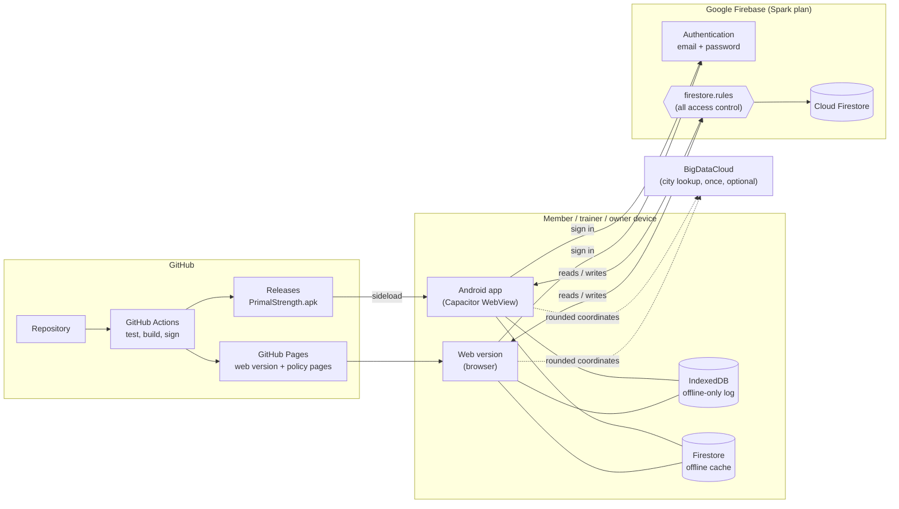
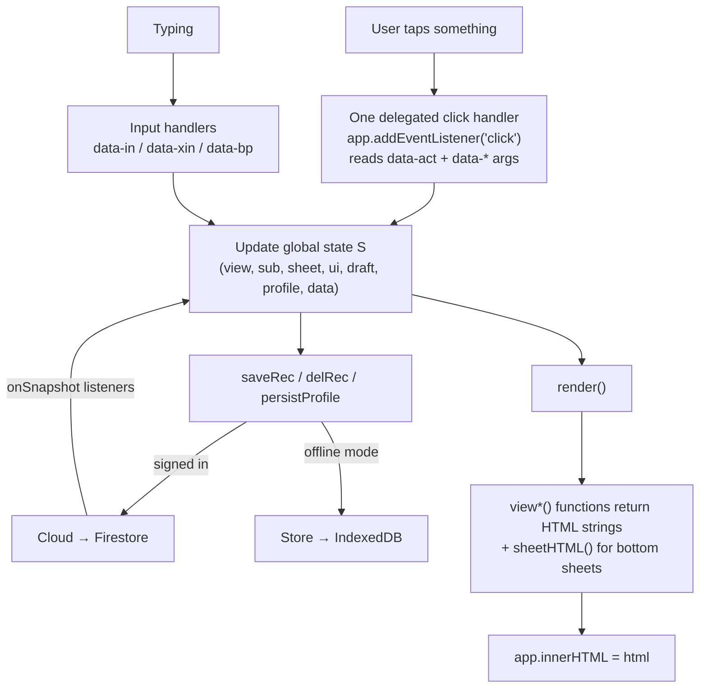
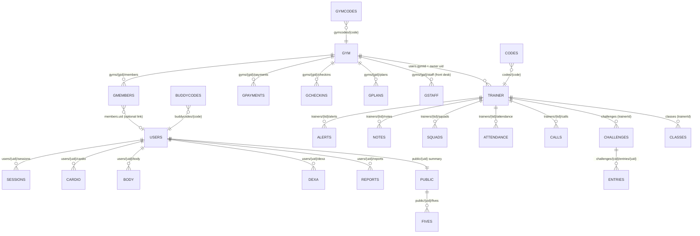
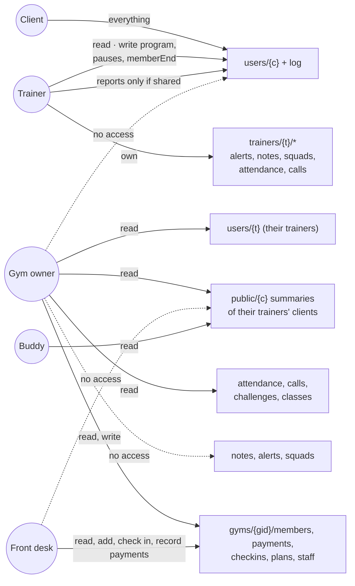
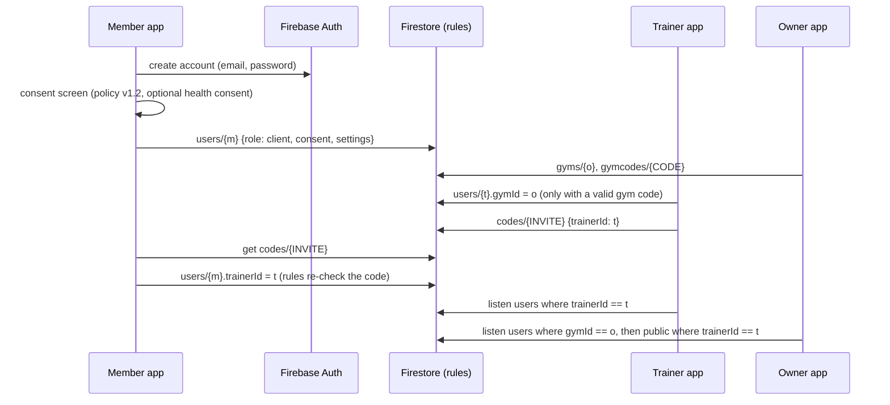
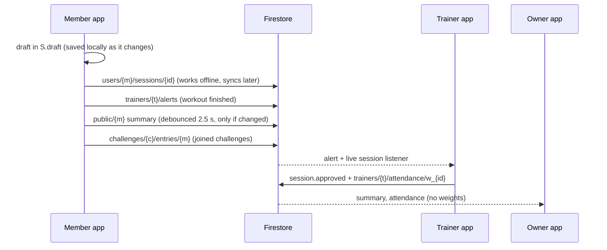
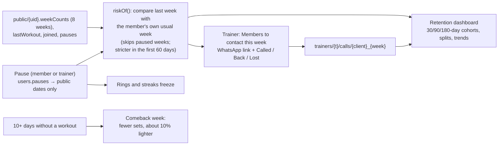
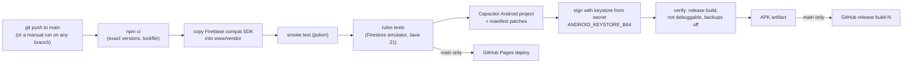

# Primal Strength: architecture and code review guide

This guide is for an outside developer reviewing the app's code, security and build. It describes the code as of the gym web app build (25 Nov 2026). Diagrams use Mermaid, so GitHub draws them.

**Contents**
1. What the app is
2. System overview (diagram)
3. Repository layout
4. Inside `www/index.html`
5. Data model (diagram)
6. Who can see what (roles and security rules)
7. Main data flows (diagrams)
8. Offline mode and database costs
9. Build, test and release pipeline (diagram)
10. Known trade-offs and risks
11. Review checklist
12. Running it locally

---

## 1. What the app is

A training app for three kinds of user:

| Role | What they do |
| --- | --- |
| **Client (member)** | Follows a program, logs workouts, cardio, check-ins, races and tests; earns points, streaks and badges; joins challenges and buddies. Works offline, without an account. |
| **Trainer** | Connects clients with an invite code; builds programs; sees clients' logs and progress; runs classes, challenges, a gym "big screen" and a weekly call list for members who are slipping. |
| **Gym owner** | Connects trainers with a gym code; sees **summaries only** of app members (counts, statuses, attendance, retention), never weights, health data or notes. Runs the **gym web app**: the gym's own member list, membership plans, hand-recorded payments with GST receipts, desk check-in, win-back and exit reasons. |
| **Front desk** | Receptionist login (`role: "desk"`) joined with a front-desk code: adds members, records payments, checks people in. No gym figures or settings. |

It ships as a sideloaded Android app (Capacitor 7, app ID `com.strengthlog.app`) and as a website on GitHub Pages (also the iPhone option for now). There is **no server code**: the backend is Firebase (Authentication with email and password, Firestore with offline persistence) on the free Spark plan. All access control lives in `firestore.rules`.

## 2. System overview



- **The same `www/` folder** is the website and the Android app's content.
- **The Firebase SDK** (compat build, v10.14.1) is copied into `www/vendor/` by CI from `node_modules`. It isn't committed. Nothing loads from third-party CDNs at runtime.
- **Without an account** (or when `www/vendor/` is missing), the app runs fully on the device using IndexedDB (`Store`).

## 3. Repository layout

| Path | Purpose |
| --- | --- |
| `www/index.html` | **The whole app**: about 6,093 lines; HTML, CSS and vanilla JavaScript in one file; no framework, no build step. |
| `www/privacy.html`, `delete-account.html`, `download.html` | Static pages: privacy policy v1.2, account deletion instructions, tester download page. |
| `firestore.rules` | Firestore security rules, the only server-side enforcement. Pasted into the Firebase console by hand after each change. |
| `firebase.json` | Emulator configuration for the rules tests. |
| `capacitor.config.json` | Android shell settings: WebView debugging off, mixed content off. |
| `test/smoke.js` | End-to-end test: loads the app in jsdom with an in-memory Firebase stand-in and clicks through every role's flows. |
| `test/rules.test.js` | 149 allow/deny checks of `firestore.rules` on Google's Firestore emulator, including a security-audit section. |
| `.github/workflows/build-apk.yml` | CI: tests, Android build, signing, release, Pages deploy. |
| `.github/workflows/rules-check.yml` | The same tests on `test/**` branches, with no release. |
| `docs/play-data-safety.md` | Play Store Data safety answers, kept in step with the privacy policy. |
| `BACKLOG.md`, `CLAUDE.md` | Product backlog and maintainer notes. |
| `README.md` | **Out of date**: it predates accounts and says data never leaves the phone. Use this guide instead. |

## 4. Inside `www/index.html`

### 4.1 Runtime model



- **State:** one global object `S` (`S.view`, `S.sub`, `S.sheet`, `S.ui`, `S.draft` for the workout being logged, `S.profile` = `{program, settings, pauses, memberEnd, since}`, `S.data` = `{sessions, cardio, body, dexa, reports}`).
- **Rendering:** `render()` rebuilds the whole `<main>` from template strings. It doesn't re-render while the user types in an input (`pendingRender`), or on the logging and builder screens unless `S.forceRender` is set.
- **Escaping:** all user text is inserted through `esc()`. This is the app's only XSS defence (there is no Content-Security-Policy), so reviewers should check every `${...}` in templates.
- **Actions:** every button carries `data-act="name"`; the handler is one long `if (a === "...")` chain starting around line 2733.
- **Role context:** trainers view a client through `withCtx(fn)`, which temporarily swaps `S.data`/`S.profile` for the client's, so the client screens and calculations are reused.

### 4.2 Code map (section headers in the file; line numbers are approximate and drift as the file grows)

| Lines (approx.) | Section | Key functions |
| --- | --- | --- |
| 250–1310 | Programs, exercise library, templates, **sports** | `LIB`, `TEMPLATES`, `SPORTS`, `curSport()`, `sportLogs()`, events, fitness tests, sport progress panels |
| 1310–1420 | Block structure | `setLabels`, `targetReps`, `targetKg`, deload and comeback adjustments |
| 1431–1520 | Storage and state | `Store` (IndexedDB, falling back to localStorage), `S`, `defaultsFor` |
| 1654–2050 | Render and member views | `render`, `viewToday`, `viewLog`, `setRef` (weight→reps via Brzycki) |
| 1962–2050 | Location and units | Everything is stored metric; display goes through `W() D() L() wOut() dOut()` |
| 2050–2196 | **Privacy** | consent screen (`CONSENT_V`, `POLICY_V`), `healthOK()`, health-data erase, **account deletion** |
| 2463–2617 | Sheets | `sheetHTML()` dispatch by `S.sheet.kind` |
| 2617–3131 | **Actions** | the delegated click handler |
| 3142–3294 | **Accounts and sync** | `cloudInit`, `onAuth`, `createUserDoc`, `cloudSaveRec`, `persistProfile`, trainer alerts |
| 3294–3540 | Trainer views, program builder | `openClient`, `withCtx`, `viewClients`, `viewClient`, builder |
| 3583–3860 | Onboarding questionnaire | `coachPlan` (generates a starter block) |
| 3868–4100 | Gamification | `pbScan`, `ringsFor`, `streakInfo`, `xpLedger`, `gameStats`, `BADGES` |
| 4144–4360 | Social | `public/{uid}` summary (`syncSocial`), buddies, high-fives, challenges |
| 4640–4900 | Coach tools | workout timers, one workout to many clients, approval = attendance, classes |
| 4924–4976 | **Bounded reads** | `attachData`, `fetchHistory`, `LIVE_DAYS`, `HISTORY_DAYS` |
| 4976–5079 | Gym big screen | `viewGym` (trainer logs for up to 6 clients) |
| 5079–5121 | Gym owner | `attachOwner`, `setupGym`, `joinGym` |
| 5121–5440 | **Retention** | `riskOf`, pauses, comeback week, call list, monthly report card, retention dashboard |
| 5437–5510 | Owner dashboard | `trainerStats`, `viewOwner`, `viewOwnerTrainer` |
| 5576– | **Gym web app** | `Hub`, `attachHub`, `viewGymSide`, members, payments and receipts (`savePayment`), check-in, settings, `ownerGymCards`, win-back, exit reasons, trainer ranking |
| end of file | Boot | `boot()` |

## 5. Data model (Firestore)



| Collection | Written by | Contents |
| --- | --- | --- |
| `users/{uid}` | the person; their trainer (program, pauses, membership end only) | `role` (client/trainer/owner), `name`, `email`, `trainerId`, `gymId`, `consent`, `settings` (incl. intake questionnaire, health answers, optional `phone`), `program`, `pauses[]`, `memberEnd`, codes |
| `users/{uid}/sessions\|cardio\|body\|dexa\|reports` | the person; trainer may create sessions (gym screen) and set `approved` | the training log; races are sessions with `day:"🏁"` and an `event` object; tests are body records with `source:"test"` |
| `public/{uid}` | the person's app (`syncSocial`); trainer may set `pauses`/`memberEnd`; others may add or remove themselves as buddies | **non-sensitive summary**: name, streak, rank, points, weekly counts (8 weeks), last workout, recent PBs, program summary, join date, pause dates, membership end |
| `trainers/{tid}/alerts` | the trainer's clients | "workout finished", "profile changed", "account deleted" |
| `trainers/{tid}/notes`, `squads` | the trainer | private notes; client groups ("troops") |
| `trainers/{tid}/attendance` | the trainer | approved workouts and class roll calls, for billing |
| `trainers/{tid}/calls` | the trainer | weekly call list outcomes: called, back, lost |
| `challenges/{cid}` + `entries/{uid}` | trainer; each client writes their own entry | coach challenges and leaderboards |
| `classes/{cid}` | the trainer | recurring classes |
| `gyms/{ownerUid}` | the owner | gym name, GSTIN, GST rate, SAC, address, receipt prefix, win-back message, front-desk code, trainer list (copied by the owner's app so the desk can assign trainers) |
| `gyms/{gid}/members` | owner, front desk (desk can't change `uid`; only the owner deletes) | the gym's member list, including people without the app: name, phone, email, trainer, plan, period, fee, balance due, status, exit reason, last visit, optional `uid` link to an app account |
| `gyms/{gid}/payments` | owner, front desk create (`by` must be the writer); only the owner edits or deletes | hand-recorded payments: plan, period, price, GST, total, paid, balance, method, reference, receipt number |
| `gyms/{gid}/counters/receipt-<FY>` | owner, front desk, inside a transaction | receipt sequence `n`; rules only allow `n` to go up by exactly 1 |
| `gyms/{gid}/checkins` | owner, front desk | one per member per day: `<memberId>_<date>` |
| `gyms/{gid}/plans` | the owner | membership plans: name, months, price before GST |
| `gyms/{gid}/staff/{uid}` | the desk user creates it with a `gymcodes` doc of `kind: "desk"`; the owner (or the user) deletes it | front-desk access; deleting it revokes access at once |
| `codes`, `gymcodes`, `buddycodes` | their owner | 8-character join codes (6-character codes from before still work); readable one at a time with `get`, never listable |

**Units:** everything is stored metric (kg, km, cm). Display conversion is per user.

## 6. Who can see what



Security model, in short:

- **Identity** comes from Firebase Auth (`request.auth.uid`). Roles are stored on `users/{uid}.role`, set once at sign-up; the rules forbid changing it later.
- **Trainer link:** a client can set `trainerId` only to the trainer named by a valid `codes/{code}` document. **Gym link:** a trainer can set `gymId` only through a valid `gymcodes/{code}`. A gym's ID is its owner's uid.
- **Trainers** read their clients' documents and logs (`isTrainerOf`), except health reports the client hasn't shared. They may change only `program`, `programUpdatedAt`, `pauses` and `memberEnd` on the client's user document, and only `approved` on a session.
- **Gym owners** read `public/{uid}` summaries, attendance, call outcomes, challenges and classes for trainers whose `gymId` is theirs (`ownsGymOfTrainer`). They can't read client user documents, logs, notes or alerts.
- **Alerts** a client writes to their trainer are limited to known fields and lengths.
- **Gym records** (`gyms/{gid}/…`) are readable and writable only by the gym's team: the owner (`isMe(gid)`) or a front desk with a staff record (`isDeskOf(gid)`, an `exists()` check). Trainers and members can't read them. Payment records are append-only for the front desk.
- **Tests:** `test/rules.test.js` has 149 allow/deny checks, including cross-account reads and writes, trainer and owner scope, code takeover, and the retention collections.

## 7. Main data flows

### 7.1 Sign-up and connecting to a trainer and gym



### 7.2 Logging a workout



### 7.3 Retention (retention build)



The risk score is calculated **in the viewer's app** from the member's public summary, so it costs no extra database reads and needs no server. A member's summary updates only when that member opens the app; a member who stops opening it keeps older weekly counts, which correctly push them towards "at risk".

## 8. Offline mode and database costs

- **Firestore offline persistence** is on (`enablePersistence`), so a signed-in member can log in a gym with no signal.
- **No account:** the log lives in IndexedDB (`Store`), with backup and restore as a JSON file.
- **Bounded reads (Spark plan: 50,000 reads a day):** `attachData()` listens live only to the last 42 days of sessions, cardio and body records (`LIVE_DAYS`). Older history comes from the phone's cache and is fetched from the server once per phone, 6 months back by default (`HISTORY_DAYS`); "Load older history" fetches the rest. Challenge leaderboards are listened to only for challenges that ended in the last 30 days. Owner and trainer listeners are scoped by `trainerId` and date (attendance 100 days, calls 8 or 26 weeks).
- **Known cost hotspot:** the rules call `get()` on user documents (`isTrainerOf`, `ownsGymOfTrainer`, `userData`). Each call is a billed read during rule evaluation, so a large gym's owner dashboard costs more reads than the number of documents it shows.

## 9. Build, test and release



- **Pinning:** every npm package is pinned to an exact version with a committed lockfile, and every GitHub Action is pinned to a commit SHA.
- **Permissions:** the build job is read-only; only the `release` job (`contents: write`) and the `web` job (`pages`) can publish, and neither installs packages.
- **Android manifest patches:** VIBRATE and COARSE_LOCATION permissions; `allowBackup=false` and data-extraction rules (no cloud backup or phone-to-phone transfer); keep-screen-on in `MainActivity`.
- **Version code** = GitHub run number. The APK is sideloaded, so it isn't on the Play Store yet.
- **Database rules** aren't deployed by CI. The maintainer pastes `firestore.rules` into the Firebase console after each change.

## 10. Known trade-offs and risks

These are the points a reviewer should weigh. Severity is our own estimate.

| # | Area | Detail | Severity |
| --- | --- | --- | --- |
| 1 | **Trust in the public summary** | `public/{uid}` is written by the member's own app. The rules check the trainer link and buddy-list size but not the numbers, so a modified client could inflate its own streak, points, weekly counts or challenge entries. Leaderboards, the risk score and the owner's statistics are only as honest as the member's app. A server (Cloud Functions, Blaze plan) would be needed to compute them. | Medium (integrity, not privacy) |
| 2 | **XSS** | The UI is built from template strings with `innerHTML`. Safety depends on `esc()` being used on every user-supplied value; there is no Content-Security-Policy. A missed `esc()` in a trainer or owner view would let one user run script in another user's app. | Medium: review every template |
| 3 | **Single 5,500-line file** | No modules, types or linter; global state. Easy to ship, hard to review and refactor. | Maintainability |
| 4 | **Rules deployed by hand** | `firestore.rules` is pasted into the console, so the live rules can drift from the repository. | Medium (process) |
| 5 | **Signing key** | The keystore is a GitHub secret with a weak, documented password (`android`), alias `androiddebugkey`. Protection rests on the secret itself. Play Store release should move to Play App Signing with a new upload key. | Medium before Play Store |
| 6 | **Firebase API key in source** | Normal for Firebase web apps (it isn't a secret), but **App Check is off** (`APP_CHECK_SITE_KEY` empty), so anyone with the key can call Auth and Firestore directly. The rules are the only defence; abuse could use up the free quota. | Low–medium |
| 7 | **Email verification and age check off** | Accounts aren't verified; the 18+ and parental-consent check is switched off (the DPDP Act needs it before onboarding minors). The code is dormant (`needsVerify`, `viewVerify`). | Product/legal |
| 8 | **Account deletion is client-driven** | The app deletes the user's documents, then the Auth user. If it's interrupted, documents can be left behind; there is no server-side clean-up. A trainer's app removes its notes about a deleted client the next time it opens. | Low–medium |
| 9 | **Rule `get()` costs** | See section 8; reads grow with gym size. | Cost |
| 10 | **Health data** | DEXA, reports, screening answers and pain scores are stored in Firestore under the user, gated by a separate consent (`healthOK()`). Report files stay on the device. Trainers see reports only when shared. | Review against DPDP |
| 11 | **Phone number** | An optional WhatsApp number is stored in `users/{uid}.settings.phone`, readable by the member and their trainer only. | Low |
| 12 | **README out of date** | It says nothing leaves the phone. | Docs |
| 13 | **Gym member list read in full** | The gym web app listens to all of `gyms/{gid}/members` (needed for desk search). Reads grow with gym size; a big gym on the free plan could use a noticeable share of the 50,000 daily reads. | Cost |
| 14 | **Receipts need a connection** | Receipt numbers come from a Firestore transaction (sequential numbers are required for GST invoices), so recording a payment fails offline. The app says so. | Low |
| 15 | **GST assumptions** | Receipts split GST into CGST + SGST (same-state buyer). The GST rate and SAC code are set by the owner; the app doesn't validate them against tax rules. Have an accountant check before relying on receipts as tax invoices. | Legal |
| 16 | **Gym-held personal data** | Gyms can record people who never agreed to the app's privacy policy (name, phone, payments). The gym is responsible for telling its members; the privacy policy (v1.3) describes it. | Review against DPDP |

## 11. Review checklist

**Security rules** (`firestore.rules`, `test/rules.test.js`)
- [ ] Can any role read another user's log, health reports, notes or alerts outside the matrix in section 6?
- [ ] Can a user change their own `role`, or link themselves to a trainer or gym without a valid code?
- [ ] Can a trainer change anything on a client other than the program, pauses, membership end and session approval?
- [ ] Are list queries (`where trainerId == …`, `where gymId == …`) provably limited by the rules?
- [ ] Are the codes (`codes`, `gymcodes`, `buddycodes`) only `get`-able, never listable?
- [ ] Run `test/rules.test.js` and look for missing deny cases.

**Client code** (`www/index.html`)
- [ ] Every `${…}` holding user-provided text (names, notes, titles, gym names, challenge titles) goes through `esc()`, including attributes and `href`s (`waLink` builds a `wa.me` URL with `encodeURIComponent`).
- [ ] No `eval`, `new Function` or HTML from the network.
- [ ] Consent: nothing is stored or sent before the consent screen; health features are gated by `healthOK()`.
- [ ] Account deletion (`deleteAccount`) removes every collection listed in section 5 for that role (an owner's deletion also removes the gym's members, payments, check-ins, plans, staff and codes).
- [ ] Gym web app: front desk can't reach owner-only actions (payment edits, plans, member deletion, app-account linking, settings), in the UI and in the rules.
- [ ] Listeners are detached on sign-out (`stopListeners`, `socialStop`, `ownerStop`) and are date- or ID-bounded.
- [ ] Units: values are stored metric and converted only for display.

**Build and supply chain** (`.github/workflows`, `package*.json`)
- [ ] Exact versions and lockfile; actions pinned to SHAs; least-privilege job permissions.
- [ ] The released APK isn't debuggable and has backups off (checked in CI).
- [ ] No secrets in the repository (the Firebase web config is public by design).

**Android shell**
- [ ] `webContentsDebuggingEnabled: false`, `allowMixedContent: false`.
- [ ] Permissions limited to INTERNET, VIBRATE and ACCESS_COARSE_LOCATION.

## 12. Running it locally

```bash
npm ci
node test/smoke.js
npx firebase emulators:exec --only firestore --project demo-primal "node test/rules.test.js"   # needs Java 21
```

To try the app quickly, open `www/index.html` in a browser. Without `www/vendor/` it runs in on-device mode (no accounts). For accounts, copy the Firebase compat SDK files into `www/vendor/` as the CI step "Bundle Firebase into the app" does, and serve `www/` over http.
